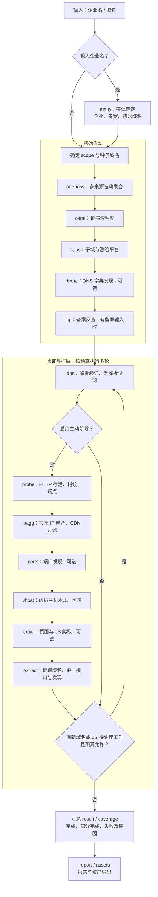
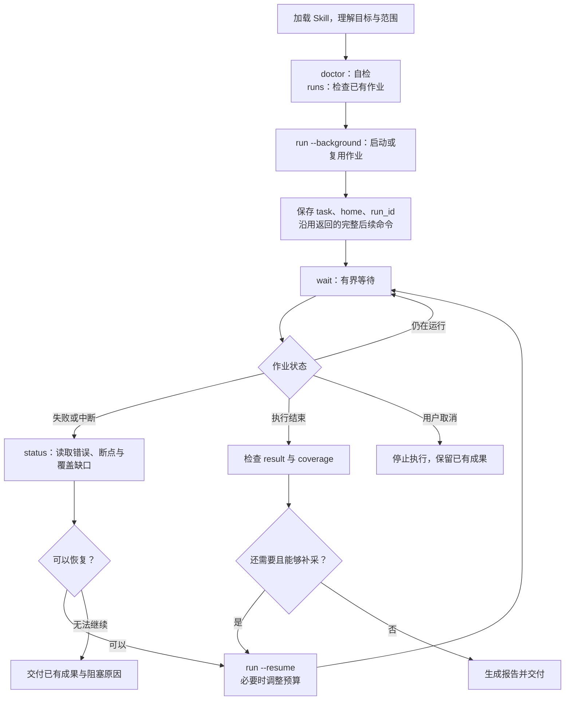
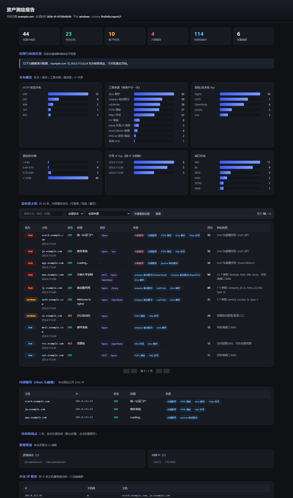

# findinfo — 资产测绘 Skill

给一个企业名或域名，产出一张带来源与置信度的资产图，供后续漏洞挖掘使用。

## 工作流程

findinfo 分为两层：**资产采集流水线**负责发现、验证和扩展资产；**Agent 作业控制流程**负责启动长任务、有界等待、恢复和交付。

### 资产采集流水线

初始发现执行一次；后续验证与扩展按轮次运行，从 DNS 阶段接收新域名和待处理工作。



- `entity` 在输入企业名时执行；`onepass` 可通过 `--no-onepass` 关闭；ICP 反查需要备案输入，且未指定 `--no-icp`。
- `--brute`、`--ports`、`--vhost`、`--crawl` 按需开启，并隐含启用主动阶段；`extract` 跟随 `crawl`。跳过的可选节点不影响后续阶段执行。
- 回流从 DNS 开始，前面的初始发现不随轮次重复；轮数、时间预算和能力限制共同决定本次实际覆盖范围。
- 图中箭头表示执行顺序。资产库保存完整数据，各阶段从库中读取输入，stdout 的展示样本不作为下游的全量输入。

### Agent 长任务控制流程

采集由后台 worker 执行，Agent 保存任务上下文，通过 `wait` 有界等待，再根据状态与覆盖缺口决定继续、恢复或交付。



- `wait` 超时只表示本次等待窗口结束，不能据此重复启动采集。
- `state=completed` 表示本次执行结束；仍需检查 `result/coverage`，区分完整完成与部分完成，并说明预算、来源和阶段缺口。
- 作业状态与断点持久化，便于换会话后查询和恢复。后台进程不会自动唤醒已经结束的 Agent 会话，进程能否持续存活也取决于宿主策略。
- 交付包括 JSON / Markdown / HTML 报告及按需导出的资产 JSONL，并注明目标、实际范围、统计、主要证据和结束原因。

## 执行环境前提（受限沙箱请先读）

skill 假定宿主满足三件事：**本地 Python ≥3.10**、**能执行仓库自带的原生二进制**（`bin/<platform>/`）、**有到被动数据源的网络出口**。跑在受限云沙箱里的 agent 可能三者都不满足——那样整个流水线不成立。一条命令验清：

    python findinfo.py doctor

看返回里的 `environment` 块：`python_ok`（版本）、`tools_summary.not_executable`（二进制被沙箱拦截时非空）、`net_egress.any_reachable`（出网）。任一不满足就到此为止，如实告知缺什么，不要硬跑。

## 快速开始

    cd <本目录>

    # Linux 发布包：先装原生二进制（Windows 包内置 bin/windows/*.exe，跳过这步）
    # Windows 发布包里没有 setup-linux.sh，脚本只随 Linux 包分发
    bash scripts/setup-linux.sh --dry-run   # 看计划
    bash scripts/setup-linux.sh --cap       # 安装 + 授权 CAP_NET_RAW

    # 0) 安装到各客户端（Claude Code / Codex / DSH），只需一次
    python scripts/install.py --status
    python scripts/install.py

    # 1) 自检（工具 + Key）
    python findinfo.py doctor

    # 2) 配 Key（可选，不配也能跑 80%）
    cp config/.env.example config/.env
    #    ENScan 的 Cookie 单独配：
    cp bin/config.example.yaml bin/config.yaml   # 再填入 aiqicha Cookie

    # 3) 纯被动测绘（零接触目标；--task 隔离资产图，长命令建议后台）
    python findinfo.py --task 企业名 run --name "企业名"

    # 4) 主动阶段
    python findinfo.py run --name "企业名" --active --vhost --crawl

    # 5) 长任务：后台起 + 有界等待（不用 nohup，不阻塞会话）
    python findinfo.py run --domain example.com --active --vhost --crawl --background
    python findinfo.py wait  --run <run_id> --timeout 30
    python findinfo.py status --run <run_id>

    # 6) 交付：agent 用 brief 查库读数（stdout 一行 JSON），report 出人看的 html/md
    python findinfo.py brief --match example.com
    python findinfo.py report --match example.com

    # 7) 导出全量（喂下游扫描器）
    python findinfo.py assets --export runs/assets.jsonl

    # 换会话/换人接手：靠 run_id 恢复，不依赖上次会话记忆
    python findinfo.py runs                # 列出最近运行（含 run_id / state）
    python findinfo.py status --run <run_id>   # 目标/范围/阶段/产物/下一步
    python findinfo.py run --resume <run_id>   # 断点续跑

## 让 Agent 使用这个 Skill

findinfo 是给 AI agent 调用的。把 [`prompts/AGENT.txt`](prompts/AGENT.txt) 整份内容作为提示词投给 agent（替换其中的占位符即可）。
工作流、硬规则、判读与交付模板都在那一份里，本文件不重复。Agent 装载后的行为约束见 [SKILL.md](SKILL.md)。

### 需要哪些 API Key（可选项，不配也能跑 80%）

纯被动阶段（`onepass` / `certs` / `subs`）里的 onepass 有 8 个免 key 数据源，不配任何 key 也能出结果；
下面这些是**扩展覆盖**用的，按需申请。填进 `config/.env`（`cp config/.env.example config/.env`）。

**缺 key 不是失败：** 没配 key 的测绘引擎会被记为 `unavailable`（覆盖缺口），
`uncover` 根本不会带着空 key 去跑。阶段照常完成、`run` 以 `complete`/`partial` 结束，
退出码不是 5。补上 key 后重跑同一目标，`subs` 会因输入哈希变化而真正重跑，不会被旧断点跳过。

| 用途 | 字段 | 申请地址 | 免费额度 |
|---|---|---|---|
| 爱企查 Cookie（企业锚定，`entity` 阶段必需） | `bin/config.yaml` → `cookies.aiqicha` | 登录 https://aiqicha.baidu.com → F12 → Network → 复制 Cookie 头 | 免费 |
| FOFA（备案反查 / 子域扩展） | `FOFA_EMAIL` + `FOFA_KEY` | https://fofa.info/userInfo | 200~300 次/月 |
| 360 Quake（备案反查 / 子域扩展） | `QUAKE_TOKEN` | https://quake.360.net/quake/#/personalInfo | 3000 次/月 |
| Hunter 鹰图（备案反查 / 子域扩展） | `HUNTER_KEY` | https://hunter.qianxin.com/home/userInfo | 100 积分/月 |
| Shodan（子域扩展，`subs` 默认引擎之一） | `SHODAN_KEY` | https://account.shodan.io/ | 极低，建议付费 |

```bash
cp config/.env.example config/.env
# 编辑 config/.env，填入：
#   FOFA_EMAIL=your@mail.com
#   FOFA_KEY=xxxxxxxx
#   QUAKE_TOKEN=xxxxxxxx
#   HUNTER_KEY=xxxxxxxx
#   SHODAN_KEY=xxxxxxxx

# 爱企查 Cookie 单独放（二进制自己读，不走 .env）：
cp bin/config.example.yaml bin/config.yaml
#   cookies:
#     aiqicha: "BAIDUID=xxxx; BDUSS=xxxx; ..."   # 整段 Cookie 头原样粘贴

python findinfo.py doctor   # 确认 api_keys 里对应项变成 true
```

> 两个文件都已在 `.gitignore` 里，不会被提交，也不会被 `install.py --copy` 复制到客户端目录。
> 空值 = 该数据源未启用，流水线跳过并在报告里记为覆盖缺口，不会报错。

> **爱企查 Cookie 只对 `entity`（企业锚定）有用。** 直接给域名（`--domain example.com`）时完全不需要它。

### 装到各客户端

agent 必须先「看得见」这个 skill 才会调用它。一条命令装到所有客户端：

```bash
python scripts/install.py            # DSH / Claude Code / Codex 一次性建链接 + 注册
python scripts/install.py --status   # 查每个客户端是否已装
python scripts/install.py --verify   # 在每个客户端路径上实跑 doctor
```

不同客户端的加载机制不一样（Codex 走 `config.toml` 注册表；Claude Desktop 的聊天/Cowork 是否能加载第三方 skill **待确认**，Code 标签可用），
细节和常见坑见 [docs/CLIENTS.md](docs/CLIENTS.md)。

### 使用边界

`--active`、`--vhost`、`--crawl`、`--brute`、`--ports` 这些**主动阶段会真实向目标发包**。
只对自己有授权的目标启用；纯被动阶段（`onepass`/`certs`/`subs`/`icp`/`dns`）零接触目标。

## 从 0.7.x 升级

0.8.0 有两处对外行为变了，升级时注意：

1. **`report` 默认只写 `report.md` 和 `report.html`**。要 `report.json` 得加 `--with-json`，
   要 `report.brief.json` 得加 `--with-brief`；stdout 的 `paths` 里不再有 `json` 键。
   脚本里原来读 `report.json` 的地方，要么改成 `report ... --with-json`，要么直接换成
   `python findinfo.py brief --run <run_id>`（stdout 一行 JSON，不落文件，给 Agent 用）。
2. **`icp --from-store` 要带范围**：`python findinfo.py icp --from-store --scope example.com`。
   ICP 表是跨项目共享的，不带 `--scope` 会把整张表都发给测绘平台。

另外 0.8.0 起 `doctor` 会说清"缺 key"，不再把它当失败——缺 key 的阶段记成覆盖缺口，
run 照常完成并交付，**不要**再对它反复 `--resume`（补上 key 重跑才会好转）。
完整变更见 [CHANGELOG.md](CHANGELOG.md)。

## 文档

| 文件 | 内容 |
|---|---|
| SKILL.md | AI 使用说明：何时用、流程、硬规则、故障处理 |
| docs/TOOLS.md | 每个命令的参数、输出 JSON、示例、内置工具能力矩阵 |
| docs/API-KEYS.md | **哪些需要 key**、申请地址、免费额度、不配的后果 |
| docs/LINUX.md | Linux 部署：装二进制、CAP_NET_RAW、systemd、故障排查 |
| docs/CLIENTS.md | 跨客户端（DSH / Claude Code / Codex / Claude Desktop）加载机制与坑 |
| docs/DATA-MODEL.md | **数据模型**：资产字段、置信度规则、报告字段口径、旧数据迁移 |
| docs/TROUBLESHOOTING.md | **故障与结果推进**：常见故障、wait 判读、来源级分支、红线 |
| docs/DEVELOPMENT.md | **开发文档**：目录结构、回归测试怎么跑（日常使用不需要看） |
| prompts/AGENT.txt | **复制给 agent 的完整工作流提示词模板**（人工复制粘贴，不参与自动加载） |
| CHANGELOG.md | 版本变更记录（含 0.7.x 升级注意） |

最终交付长这样（`findinfo.py report` 产出的 html 看板，可打印成 PDF）：



## 内置工具

二进制随发布包分发、开箱即用（Linux 包里用 `scripts/setup-linux.sh` 现场安装，该脚本只在 Linux 包中提供），能力矩阵与每个命令的详细参数见 [docs/TOOLS.md](docs/TOOLS.md)；在场/可执行/版本自检用 `python findinfo.py doctor`。


## 核心设计

1. **确定性优先**：能工具化的不交给模型，所有工具返回结构化数据
2. **provenance + confidence**：每条资产记录谁发现的、几个**独立上游**、可信度；同一上游经不同入口只算一票，重复跑/乱序不提升置信度
3. **幂等 + 增量**：findinfo.db 是唯一真值，重复跑只更新 sources
4. **被动/主动物理分离**：`--active` 之前不产生任何目标流量
5. **任务隔离**：`--task 名字` 各任务独立数据库（中文名映射到稳定的 `tasks/task-<hash>` 目录）
6. **断点续跑**：阶段按输入哈希 checkpoint；**阶段失败（如工具 rc=124）不写 done**，重跑自动重试
7. **范围控制**：`run` 只主动触达种子域名；范围外域名只入库报告，不扩大主动范围（用公共后缀表推导范围）

字段含义、置信度规则、展示上限与旧数据迁移口径统一写在 [docs/DATA-MODEL.md](docs/DATA-MODEL.md)。

## 运行状态与失败语义

- `findinfo.py status`：心跳（每 30s 刷 status.json）+ pid 判活；超过 90s 无心跳或进程不在即 `alive=false`。
- 阶段状态：`done` / `failed`（**部分结果仍保留**且下游可用，重跑自动重试）/ `skipped`（checkpoint 命中）。
- 退出码：0 成功 / 2 业务错 / 4 工具缺失 / 5 阶段失败（含部分结果）。
- 逐条判读见 [docs/TROUBLESHOOTING.md](docs/TROUBLESHOOTING.md)。

