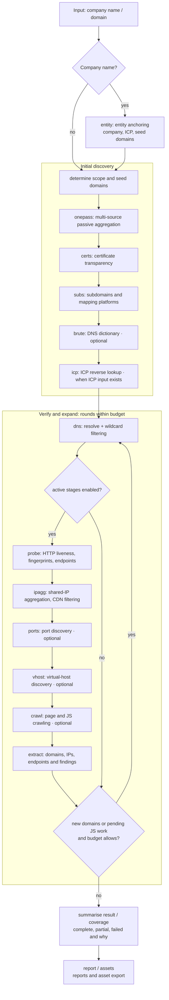
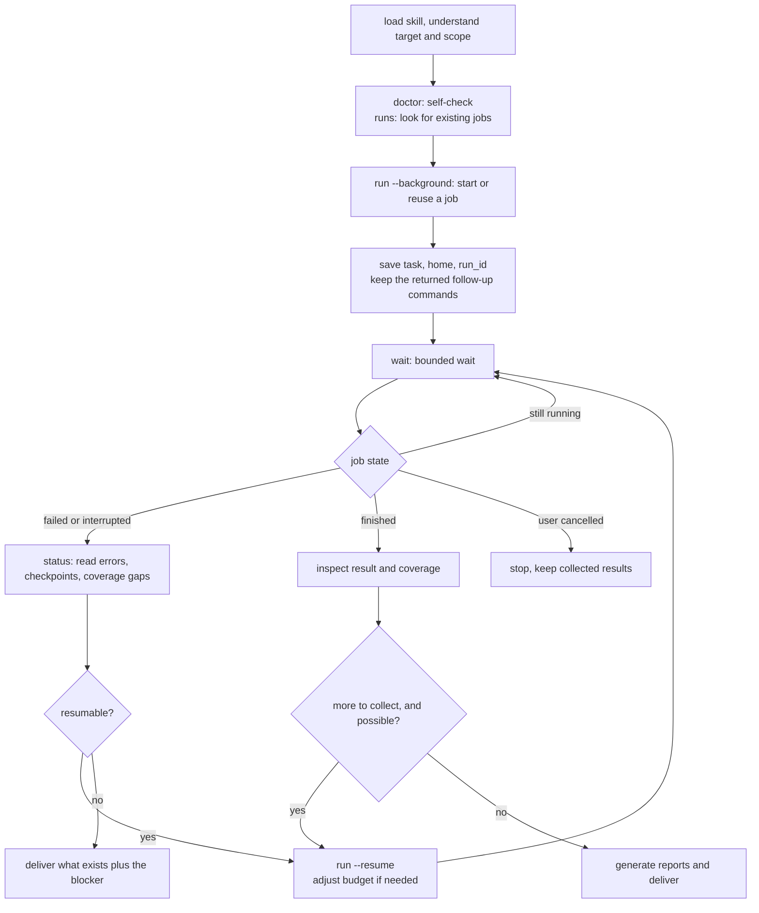

# findinfo — asset reconnaissance skill

Give it a company name or a domain and it produces an asset graph with provenance and confidence, ready for vulnerability hunting.

## Workflow

findinfo has two layers: the **asset collection pipeline** discovers, verifies and expands assets; the **agent job-control loop** starts long jobs, waits in bounded windows, resumes and delivers.

### Asset collection pipeline

Initial discovery runs once; verification and expansion then run in rounds, receiving new domains and pending work from the DNS stage.



- `entity` runs when the input is a company name; `onepass` can be disabled with `--no-onepass`; ICP reverse lookup needs ICP input and no `--no-icp`.
- `--brute`, `--ports`, `--vhost`, `--crawl` are opt-in and imply active stages; `extract` follows `crawl`. Skipping an optional node never blocks later stages.
- Reflow starts at DNS; the earlier discovery stages are not repeated per round. Rounds, time budget and capability limits together decide actual coverage.
- Arrows show execution order. The asset store holds the full data; stages read their inputs from the store, and stdout display samples are never the downstream input.

### Agent long-job control loop

Collection runs in a background worker; the agent keeps the task context, waits in bounded windows via `wait`, then decides to continue, resume or deliver based on state and coverage gaps.



- A `wait` timeout only ends that wait window; it is never a reason to start another collection.
- `state=completed` means this execution finished; still check `result/coverage` to distinguish full from partial completion and explain budget, source and stage gaps.
- Job state and checkpoints persist, so a new session can query and resume. Background processes never wake a finished agent session, and their survival depends on host policy.
- Delivery includes reports plus an on-demand asset JSONL export, stating target, actual scope, statistics, main evidence and the end reason.

## Execution prerequisites (read this first in restricted sandboxes)

The skill assumes three things about the host: **local Python ≥3.10**, **the bundled native binaries can execute** (`bin/<platform>/`), and **there is network egress to the passive sources**. An agent inside a restricted cloud sandbox may fail all three — then the whole pipeline is a non-starter. One command checks everything:

    python findinfo.py doctor

Look at the `environment` block: `python_ok` (version), `tools_summary.not_executable` (non-empty when the sandbox blocks binaries), `net_egress.any_reachable` (egress). If any check fails, stop there and report what is missing; do not force a run.

## Quick start

    cd <this directory>

    # Linux release package: install native binaries first (the Windows package
    # ships bin/windows/*.exe and has no setup-linux.sh — script is Linux-only)
    bash scripts/setup-linux.sh --dry-run   # see the plan
    bash scripts/setup-linux.sh --cap       # install + grant CAP_NET_RAW

    # 0) install into every client (Claude Code / Codex / DSH), once
    python scripts/install.py --status
    python scripts/install.py

    # 1) self-check (tools + keys)
    python findinfo.py doctor

    # 2) configure keys (optional; ~80% works without them)
    cp config/.env.example config/.env
    #    ENScan's Cookie is configured separately:
    cp bin/config.example.yaml bin/config.yaml   # then paste the aiqicha Cookie

    # 3) purely passive mapping (zero target contact; --task isolates the graph)
    python findinfo.py --task mycorp run --name "My Corp"

    # 4) active stages
    python findinfo.py run --name "My Corp" --active --vhost --crawl

    # 5) long jobs: background + bounded wait (no nohup, no blocking)
    python findinfo.py run --domain example.com --active --vhost --crawl --background
    python findinfo.py wait  --run <run_id> --timeout 30
    python findinfo.py status --run <run_id>

    # 6) delivery: agents read `brief` (one JSON line on stdout), humans get html/md
    python findinfo.py brief --match example.com
    python findinfo.py report --match example.com

    # 7) export the full set (feed downstream scanners)
    python findinfo.py assets --export runs/assets.jsonl

    # New session / handover: recover by run_id, never by memory of the last session
    python findinfo.py runs                # recent runs (run_id / state)
    python findinfo.py status --run <run_id>   # target/scope/stages/artifacts/next
    python findinfo.py run --resume <run_id>   # resume from checkpoints

## Using this skill with an agent

findinfo is built for AI agents. Paste the whole of [`prompts/AGENT.txt`](prompts/AGENT.txt) as the prompt (replace its placeholders).
Workflow, hard rules, result reading and the delivery template all live in that one file. Behaviour after loading is governed by [SKILL.md](SKILL.md).

### Which API keys (optional; ~80% works without them)

onepass (inside `onepass` / `certs` / `subs`) has 8 key-free sources, so results come out with no keys at all;
the ones below only **widen coverage**. Put them in `config/.env` (`cp config/.env.example config/.env`).

**A missing key is not a failure:** keyless mapping engines are recorded as `unavailable` (a coverage gap);
`uncover` is never run with an empty key. Stages complete normally, `run` ends `complete`/`partial`,
exit code stays ≠5. After adding a key, re-running the target really re-runs `subs` (the input hash changed) instead of being skipped by old checkpoints.

| Purpose | Field | Where to get it | Free tier |
|---|---|---|---|
| aiqicha Cookie (entity anchoring, required by `entity`) | `bin/config.yaml` → `cookies.aiqicha` | log in at https://aiqicha.baidu.com → F12 → Network → copy the Cookie header | free |
| FOFA (ICP reverse lookup / subdomain expansion) | `FOFA_EMAIL` + `FOFA_KEY` | https://fofa.info/userInfo | 200–300/month |
| 360 Quake (ICP reverse lookup / subdomain expansion) | `QUAKE_TOKEN` | https://quake.360.net/quake/#/personalInfo | 3000/month |
| Hunter (ICP reverse lookup / subdomain expansion) | `HUNTER_KEY` | https://hunter.qianxin.com/home/userInfo | 100 credits/month |
| Shodan (subdomain expansion, one of `subs`' default engines) | `SHODAN_KEY` | https://account.shodan.io/ | very low, paid recommended |

```bash
cp config/.env.example config/.env
# edit config/.env and fill in:
#   FOFA_EMAIL=your@mail.com
#   FOFA_KEY=xxxxxxxx
#   QUAKE_TOKEN=xxxxxxxx
#   HUNTER_KEY=xxxxxxxx
#   SHODAN_KEY=xxxxxxxx

# The aiqicha Cookie lives separately (the binary reads it, not .env):
cp bin/config.example.yaml bin/config.yaml
#   cookies:
#     aiqicha: "BAIDUID=xxxx; BDUSS=xxxx; ..."   # paste the whole Cookie header

python findinfo.py doctor   # the api_keys entries turn true
```

> Both files are in `.gitignore`, never committed, and never copied into client directories by `install.py --copy`.
> An empty value = that source is disabled; the pipeline skips it and records a coverage gap instead of erroring.

> **The aiqicha Cookie only matters for `entity` (company anchoring).** When you start from a domain (`--domain example.com`) you never need it.

### Installing into clients

An agent must be able to "see" the skill before it can call it. One command covers every client:

```bash
python scripts/install.py            # link + register into DSH / Claude Code / Codex
python scripts/install.py --status   # what is installed where
python scripts/install.py --verify   # run doctor on every client path
```

Clients load skills differently (Codex uses a config.toml registry, the rest scan a skills directory);
details and known pitfalls in [docs/CLIENTS.md](docs/CLIENTS.md).

### Boundaries of use

`--active`, `--vhost`, `--crawl`, `--brute`, `--ports` are **active stages that send real traffic to the target**.
Enable them only for targets you are authorised to test; the passive stages (`onepass`/`certs`/`subs`/`icp`/`dns`) never touch the target.

## Upgrading from 0.7.x

Two externally visible behaviours changed in 0.8.0:

1. **`report` writes only `report.md` and `report.html` by default.** Add `--with-json` for
   `report.json`, `--with-brief` for `report.brief.json`; stdout's `paths` no longer has a `json` key.
   Scripts that read `report.json` should either switch to `report ... --with-json` or use
   `python findinfo.py brief --run <run_id>` (one JSON line on stdout, no files — the agent read API).
2. **`icp --from-store` requires a scope**: `python findinfo.py icp --from-store --scope example.com`.
   The ICP table is shared across engagements; without `--scope` the whole table goes to the mapping platforms.

Also, since 0.8.0 `doctor` reports missing keys as gaps instead of failures — stages with missing keys are coverage
gaps, the run still completes and delivers; do **not** loop `--resume` on them (adding the key and re-running is what
helps). Full history in [CHANGELOG.md](CHANGELOG.md).

## Documentation

| File | Contents |
|---|---|
| SKILL.md | AI usage: when to use, flow, hard rules, failure handling |
| docs/TOOLS.md | Parameters, output JSON and examples per command, plus the bundled-tool capability matrix |
| docs/API-KEYS.md | **Which sources need keys**, signup links, free tiers, consequences of not configuring |
| docs/LINUX.md | Linux deployment: binaries, CAP_NET_RAW, systemd, troubleshooting |
| docs/CLIENTS.md | Cross-client (DSH / Claude Code / Codex) loading mechanics and pitfalls |
| docs/DATA-MODEL.md | **Data model**: asset fields, confidence rules, report field semantics, legacy migration |
| docs/TROUBLESHOOTING.md | **Failures and result progression**: common failures, reading `wait`, per-source branching, red lines |
| docs/DEVELOPMENT.md | **Development**: directory layout, how to run the regression suite (not needed for daily use) |
| prompts/AGENT.txt | **The complete workflow prompt to copy to an agent** (manual copy-paste, not auto-loaded) |
| CHANGELOG.md | Version history (incl. 0.7.x upgrade notes) |

The final deliverable looks like this (the html dashboard from `findinfo.py report`, printable to PDF):


## Bundled tools

Binaries ship with the release package and work out of the box (Linux packages install them via `scripts/setup-linux.sh`, which ships only in the Linux package). The capability matrix and per-command parameters live in [docs/TOOLS.md](docs/TOOLS.md); presence/executability/version self-check: `python findinfo.py doctor`.


## Core design

1. **Determinism first**: anything tool-able is not left to the model; every tool returns structured data
2. **provenance + confidence**: every asset records who found it, how many **independent upstreams** vouch for it, and a confidence score; the same upstream counts once however it is entered, and re-runs/reordering never inflate confidence
3. **Idempotent + incremental**: findinfo.db is the single source of truth; re-runs only update sources
4. **Passive/active separation**: zero target traffic before `--active`
5. **Task isolation**: `--task <name>` gives each engagement its own database (non-ASCII names map to a stable `tasks/task-<hash>` directory)
6. **Resumable**: stages checkpoint on input hashes; **a failed stage (e.g. tool rc=124) never writes done** and retries on the next run
7. **Scope control**: `run` only actively touches seed domains; out-of-scope domains are stored and reported but never widen the active scope (scope derivation uses the public-suffix table)

Field meanings, confidence rules, display caps and legacy-migration semantics are consolidated in [docs/DATA-MODEL.md](docs/DATA-MODEL.md).

## Run state and failure semantics

- `findinfo.py status`: heartbeat (status.json refreshed every 30s) + pid liveness; no heartbeat for 90s or a dead pid means `alive=false`.
- Stage states: `done` / `failed` (**partial results kept** and usable downstream, retried on re-run) / `skipped` (checkpoint hit).
- Exit codes: 0 ok / 2 usage error / 4 tool missing / 5 stage failure (with partial results).
- Line-by-line reading in [docs/TROUBLESHOOTING.md](docs/TROUBLESHOOTING.md).
