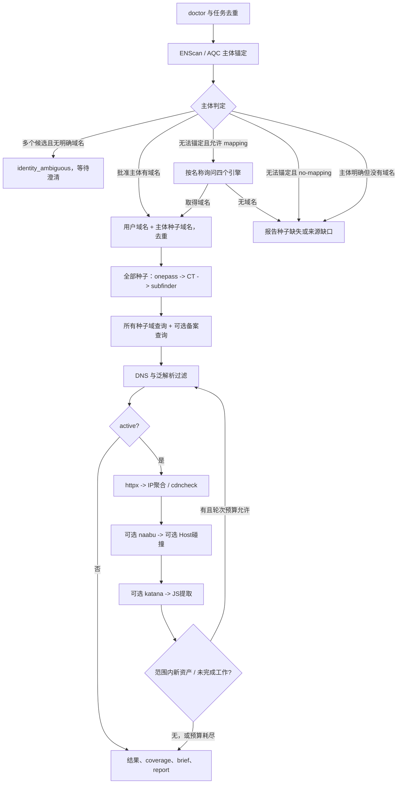

# 滴滴资产收集：当前生产流程、工具调用与测绘语法

核对日期：2026-11-22。基于 v0.8.1 工作树，包含本轮全根域默认及 Agent 接口修复。本文是离线代码推演，没有查询滴滴、AQC 或测绘平台，也没有读取实际 Cookie/Key。

## 1. 输入与范围

用户输入：`收集滴滴资产`。按用户描述，已有 AQC Cookie，以及 Shodan、FOFA、Quake、Hunter 的可用凭据。`shadan` 在本文按 Shodan 理解；CLI 必须写 `shodan`，不能把拼写错误当作有效引擎。

- AQC：由 ENScan 使用，查询公司、股权、备案和 APP 等，不是 uncover 的测绘引擎。
- 测绘引擎：显式选择 `--engines fofa,quake,hunter,shodan`，避免默认列表中的其他引擎产生无关缺口。
- 原生工具由 `lib/core.py:tool()` 从 `bin/windows/` 解析；下面省略绝对路径，但不会回退到 PATH 随意选择同名程序。
- `ROOT`：从本次批准主体取得或用户明确给出的一个种子域。`ICP`：对应主体的实际备案号。本文不猜测任何真实滴滴域名、主体全称和备案号。
- 全部根域：指程序当前种子集合全部参与扩展；不代表已经找齐集团全部主体、品牌与根域。当前输入域名也不会自动被统一提升为可注册父域。
- 默认 `--max-seed 0`，全部种子执行 onepass/certs/subs；正整数显式限制前 N 个。启用 brute 时也使用这一种子集合。mapping 原本就查询全部 scope 种子，不受该参数限制。

## 2. Agent 外层调用

现在仅查看计划，可执行以下纯离线命令。它不会验证配置是否真的可用，也不会预测 AQC 实际返回哪些域名。

```powershell
python findinfo.py --task didi run --name "滴滴" --engines fofa,quake,hunter,shodan --max-seed 0 --dry-run
```

实际采集会产生外部请求；下列是流程示例，本次没有执行。

```powershell
python findinfo.py --task didi doctor
python findinfo.py --task didi runs --active
python findinfo.py --task didi run --name "滴滴" --engines fofa,quake,hunter,shodan --max-seed 0 --background
```

普通 doctor 包含工具/环境/出口检查。`doctor --check-mapping` 还会发小额测绘自检请求，不应把它当成零请求检查，也不应每轮 wait 都调用。

默认 run 计划是 `entity -> onepass -> certs -> subs -> mapping -> dns`。它没有 HTTP/端口/Host 碰撞/爬虫阶段。DNS 仍会产生解析请求，因此这里的“被动 run”不是“完全离线”。

若已确认主动收集范围，完整 Web 攻击面流程示例为：

```powershell
python findinfo.py --task didi run --name "滴滴" --engines fofa,quake,hunter,shodan --max-seed 0 --active --ports --vhost --crawl --rounds 3 --background
```

这里 3 轮是显式选择，默认仍是 1 轮。`--ports/--vhost/--crawl` 本身也会启用 active；配置了测绘凭据不等于启用了这些阶段。没有加 `--brute`，因此不会默认做字典爆破。



## 3. Stage entity：ENScan 使用 AQC

Python 调用：

```python
tools.t_enscan(store, "滴滴", invest=51, deep=1,
               outdir=run_dir / "enscan", timeout=1200,
               supplier=False, branch=False)
```

默认原生命令：

```text
enscan.exe -n 滴滴 -invest 51 -deep 1 -json -out-dir <run_dir/enscan> -type aqc -delay 2 -is-fast -field icp,app,wx_app,wechat,copyright,invest,enterprise_info
```

1200 秒是 Python 包装器的阶段超时，不是给 ENScan 添加的原生参数。ENScan 在进程锁与跨进程文件锁内串行执行，解析本次新产生的文件；按主体分别整理公司、域名、备案、APP/小程序名称等。

此后有四个分支：

1. **主体匹配且有域名**：批准主体的域名进入种子集合，备案进入 mapping 输入。供应商/分支默认关闭，深度 1 不等于穷尽集团。
2. **多个主体候选**：无明确 `--domain` 时可能返回 `identity_ambiguous`，Agent 必须展示候选，不应自己选一个继续。
3. **无法锚定**：允许 mapping 时调用 `mapdispatch.resolve_by_name(..., kind="domain")`，实际按下一节的“名称兜底”查询。启用 `--no-mapping` 时不再派发这一付费兜底。
4. **主体明确但域名为空**：当前会报告 `seed_domain_required` 并给出公司名搜索建议，不会自动完成一轮完整的主体名称检索再继续。显式给出已确认域名可以提供种子。

**“滴滴”是两字品牌，这一门禁尤其重要。** 当前 `name_matches` 的包含式匹配要求较短名称至少 4 个字符；AQC 返回一个含“滴滴”的长公司全称，不会仅因包含这两个字就被认可。实际是否进入名称兜底取决于返回数据，本次未验证。最可靠的输入是已经确认的法律主体名称，配合明确的批准域名。

## 4. 名称兜底：当前真的会问什么

这是 entity 阶段中的条件分支，不是正常域名查询阶段的替代品。默认 kind 是 domain，源码注释提到 ICP 搜索，但默认调用不会同时再问一遍 ICP。

| 引擎 | 对 `滴滴` 的默认实际模板渲染 |
|---|---|
| FOFA | `domain="滴滴"` |
| Quake | `domain:"滴滴"` |
| Hunter | `domain="滴滴"` |
| Shodan | `hostname:"滴滴"` |

原生派发形式与正常 mapping 相同，只有查询值不同：

```text
uncover.exe -q <单个引擎自己的查询> -e <fofa|quake|hunter|shodan> -json -silent -limit 3000
```

这不是标题、组织、品牌或备案主体的语义搜索。不能据此保证搜到滴滴主域。当前代码还会把返回域以 `mapping:name`、confidence=0.9 提升为批准种子；本轮接口修复没有改变这一归属策略。专业交付中仍需单独说明该风险，不能把命中直接当成已核验归属。

## 5. Stage onepass / certs / subs：遍历全部种子

依次完成整个 onepass 阶段、整个 certs 阶段、整个 subs 阶段。Python 按种子循环；不是为每个域启动一条包含全部阶段的独立 run。

### onepass：免费聚合

```python
for root in seeds:
    tools.t_onepass(store, root)
```

```text
onepass.exe query --domain ROOT --max-pages 20
```

`--max-pages` 来源于默认 `limits.mapping_pages=20`，不是测绘平台请求次数。当前没有向该进程注入测绘密钥，默认可用的 8 个免钥源为：crtsh、certspotter、hackertarget、rapiddns、anubis、alienvault、threatminer、subdomain_center。源码存在 15 个来源定义，不等于当前流程默认调用了 15 个可用来源。

### certs：独立证书透明度查询

```python
tools.t_certs(store, root, timeout=tool_timeout)
```

通过 `core.curl_json` 访问以下模板，先查 crt.sh，无法取得结果时回退 CertSpotter；成功响应缓存 7 天。

```text
https://crt.sh/?q=%25.ROOT&output=json
https://api.certspotter.com/v1/issuances?domain=ROOT&include_subdomains=true&expand=dns_names
```

这与 onepass 中的 CT 来源可能重复，去重后不能当成两份独立证据。

### subs：免钥 subfinder

```python
tools.t_subs(store, root, engines="fofa,quake,hunter,shodan", ...)
```

```text
subfinder.exe -d ROOT -all -recursive -silent -json -pc <程序创建的空provider配置>
```

虽然保留 engines 参数，当前此适配器不派发付费引擎；不会在这里再次调用四个测绘平台，也不会因为配有钥匙就额外调用 Chaos。

## 6. Stage mapping：域名与备案的实际查询

### 域名：所有 scope 种子 × 4 个引擎

```python
mapdispatch.ask_all(store, run_id, "domain", all_seed_values,
                    engines="fofa,quake,hunter,shodan",
                    remap=False, timeout=tool_timeout, ledger=ledger)
```

| 引擎 | 一个种子 `ROOT` 的默认查询 | 原生工具调用 |
|---|---|---|
| FOFA | `domain="ROOT"` | `uncover.exe -q 'domain="ROOT"' -e fofa -json -silent -limit 3000` |
| Quake | `domain:"ROOT"` | `uncover.exe -q 'domain:"ROOT"' -e quake -json -silent -limit 3000` |
| Hunter | `domain="ROOT"` | `uncover.exe -q 'domain="ROOT"' -e hunter -json -silent -limit 3000` |
| Shodan | `hostname:"ROOT"` | `uncover.exe -q 'hostname:"ROOT"' -e shodan -json -silent -limit 3000` |

表内命令是 PowerShell 引号形式，Python 生产路径用 argv 数组派发，不依赖 shell 解析。

### 备案：实际 ICP 输入 × 支持该语法的引擎

```python
mapdispatch.ask_all(store, run_id, "icp", icp_codes,
                    engines="fofa,quake,hunter,shodan", ...)
```

| 引擎 | 默认查询 | 行为 |
|---|---|---|
| FOFA | `icp="ICP"` | 使用 uncover，或已配置的 FOFA gateway |
| Quake | `icp:"ICP"` | uncover 单独派发 |
| Hunter | `icp.number="ICP"` | uncover 单独派发 |
| Shodan | 无 | 跳过并说明没有 ICP 模板，不制造猜测语法 |

`--no-icp` 只跳过备案 mapping，仍保留域名 mapping；`--no-mapping` 跳过全部付费 mapping，包括名称兜底。`--remap` 显式重新询问已有账本问题，本轮修复使它在后台重放和名称兜底中均被保留。

### 查询、配额与缓存的边界

- 以上是当前源码的**默认模板**。`mapping.queries.domain/icp.<engine>` 可覆盖模板；本次未读取用户配置，也未向平台验证当前账户权限和语法接受情况。
- 每次只给被调用的引擎注入其凭据；不会把四家钥匙一起交给 subfinder、katana 等进程。
- FOFA 若配置可用 gateway，则直接调用 `core.fofa_query`，请求 gateway 的 `/api/v1/query`，同一查询不会再通过 uncover 重复派发。
- 默认行上限是 **3000**；`limits.mapping_rows_<engine>` 优先于统一 `limits.mapping_rows`。满上限标记截断，不等于已经翻到最后一页。
- 问题与回答保存在任务的 mapping 账本。没有 `--remap` 时复用已有结果；鉴权/限流/截断必须进入覆盖缺口。
- D 个不同域名、I 个待询问备案输入，在无缓存且所有凭据可用时，模板组合约为 `4D + 3I`；名称兜底最多再涉及 4 个组合。组合数不是 HTTP 请求数或实际账单，内部分页、权限探测及网关会改变请求量。
- 当前备案 `-1/-2` 后缀可在查询渲染后形成不同身份，已有离线重复派发反例；本轮未重构该去重。也不能把 `dispatched` 字段直接解释为真实扣费次数。

测绘得到的范围外域名可以作为相关资产保留，不能因为同一备案或搜索命中就自动批准进入新的主动 scope。

## 7. Stage dns：全部范围内候选进入解析

```python
tools.t_dns(store, all_domains, timeout=tool_timeout, states=dns_states)
```

普通路径先用随机名称建立泛解析证据，再批量解析：

```text
dnsx.exe -a -resp -silent -json
dnsx.exe -l <候选域名文件> -a -cname -resp -silent -json -t 100
```

第一条的随机域名经 stdin 提供；第二条的 100 来自默认 DNS 并发。系统解析器 fallback、fake-IP/DoH 切换由环境与配置决定，不是假定每个目标都会调用三遍。DNS 问题仍按上一轮约定暂缓修改；这里仅记录真实阶段位置。

## 8. active 阶段：画像、端口和虚拟主机

### probe：httpx

```text
httpx.exe -l <已解析域名文件> -silent -json -sc -title -tech-detect -ip -cname -cdn -favicon -tls-grab -threads 50 -timeout 10 -retries 1
```

Python 为 `tools.t_httpx(..., scope=scope)`。保存 HTTP 状态、标题、技术、地址、CDN 和证书；范围内 SAN 进入后续 DNS，范围外 SAN 作为相关线索。50 是默认 HTTP 并发，外层 tool timeout 与 `-timeout 10` 不是同一层。

### ipagg：共享 IP 与 CDN

```text
cdncheck.exe -i <范围内IP文件> -json -silent
```

`tools.t_ipagg(store, scope=scope)` 根据域/IP关系聚合。当前 candidate 要求同一 IP 至少关联两个范围内域名，并排除识别出的 CDN/WAF 地址。没有共享 IP 候选不代表没有独占源站。

### ports：仅当 --ports

```text
naabu.exe -l <候选IP文件> -top-ports 1000 -silent -json -rate 1000
```

优先扫描 ipagg candidates，没有时回退 scope IP；过滤非公网地址。top ports 默认 1000，不是全端口。适配器还尝试有限预算的端口 TLS 证书读取，但当前 run 没有完整消费这些 SAN 作为下一轮输入。

### vhost：仅当 --vhost，在 ports 之后

```text
hostCollision.exe -uf <IP_URL文件> -df <Host候选文件> -o <结果文件> -t 20 -r 100 -silent
```

Python 为 `tools.t_vhost(..., ports=[80,443,8080,8443])`。默认最多 10 个 candidate IP，Host 候选来自已知范围内域名，默认跳过已存活的域名。部分情形使用 curl 差分补充，比较直接 IP、随机 Host 和候选 Host 的响应。

这不是全网 Host 穷举，也没有自动把 naabu 的所有新端口送入碰撞。当前对固定端口的限制仍然存在；本轮只取消了根域默认上限。

## 9. crawl / extract：仅当 --crawl

```text
katana.exe -list <存活URL文件> -jc -kf all -d 3 -silent -j -or -ob -fs <范围正则>
```

`tools.t_crawl` 保存 URL、方法和 endpoint。默认深度 3；默认外层爬虫超时 2700 秒，显式 tool timeout 可覆盖。大量域名时范围正则按可注册域归并分批，输出再严格过滤。

随后调用：

```python
tools.t_extract(store, [], urls=stored_urls,
                scope=scope, run_id=run_id, timeout=tool_timeout)
```

从真正的 `.js/.mjs` URL 建立持久工作项，领取租约，以 `core.curl` 下载并正则提取域名/IP/API 路径/秘密模式。默认每次 fetch budget 2000，并发最多 10；未处理项保留到后轮或恢复。当前没有浏览器登录态、JS 动态执行或 source-map 下载解析。

新发现的范围内域名、HTTP SAN 与剩余工作驱动下一轮 `dns -> probe -> ipagg -> ports? -> vhost? -> crawl? -> extract?`。onepass/certs/subs/mapping 不会因为进入下一轮就全部重跑；范围外相关域也不会自动成为新根域种子。部分 JS 跨根候选与发现提交仍有已知边界，见能力评审。

## 10. 长时间等待、恢复与交付

启动取得 RUN_ID 后始终使用同一 task、同一 run_id：

```powershell
python findinfo.py --task didi wait --run RUN_ID --timeout 30
python findinfo.py --task didi wait --run RUN_ID --timeout 30 --since CURSOR
python findinfo.py --task didi status --run RUN_ID
python findinfo.py --task didi brief --run RUN_ID
python findinfo.py --task didi report --run RUN_ID --slug didi
python findinfo.py --task didi assets --export didi-assets.jsonl
```

`CURSOR` 应使用上次 wait 返回的 cursor；旧调用方传原始心跳 seq 仍兼容，但不推荐作为进度游标。超时只结束当前等待窗口；没有终态时继续等待，不重新启动收集。Agent 会话退出后再进入，用 `runs --active/status` 恢复观察。

worker 确认中断后，可 `run --resume RUN_ID`；本轮修复会保存 mapping 开关与原始执行参数，不能在恢复时悄悄改变已存来源策略。旧任务原有种子预算也不因新默认值扩大。宿主是否允许后台进程长期存活仍取决于执行环境，多小时存活未在本次验证。

终态有 completed/failed/cancelled；completed 仍要看 result 与 coverage。轮次、时间、行数上限或缺失来源均可能使结果 partial。brief 成功时遵守输出字节上限，截断有标记；必要身份与覆盖结论无法放入过小预算时明确报错。

`--task didi` 用于隔离此次目标。示例 JSONL 导出包含该任务库的累计数据；若任务曾收集别的范围，应另建任务或显式 match。报告中的数量也不能直接当成当前 run 的新增数量。

## 11. 本轮固定流程核对结论

已修复：默认前 5 根域上限、后台 mapping 开关丢失、wait 游标不推进、长 brief 超限；同时补齐 no-mapping 名称兜底与 no-icp 备案分支门禁，并统一恢复预览的参数转换。

已同步文档：免钥来源默认实际 8 个、subs 不调用付费引擎、mapping 独立派发、实际 ports 在 vhost 之前、测绘默认行上限 3000，以及累计库与本次发现的区别。

仍有的收集边界：品牌名主体匹配与名称兜底归属、集团主体穷尽、测绘截断的继续策略、备案后缀去重、固定 vhost 预算、JS 深度及发现保全、端口证书回流。不能用“全部根域默认遍历”替代“集团全部资产已经收齐”的证据。

## 12. 本轮验证

在不含实际配置/凭据的隔离副本中，以启动级 guard 禁止网络、DNS 和原生进程执行。100 个 Python 文件均通过 AST 解析，与审查工作树逐文件哈希一致。

选择 15 个相关模块，共 161 项：157 通过，4 项因原测试仍进入外部采集或进程控制路径而被保护拦截，未计为通过；其余无失败。新加的全根域、mapping 参数与门禁、wait cursor 回归全部通过；brief/输出/coverage 相关 29 项通过，文档命令 20 项通过。SKILL 入口仍在项目 15360 字节预算内。

另外通过真实 CLI 的纯离线入口验证 3 个计划：默认被动 6 阶段、完整主动选项 12 阶段、no-mapping 排除测绘；max_seed 均为 0，run_id 为 null，没有创建真实采集任务。真实上游兼容性、当前凭据权限和多小时后台存活不在本次验证范围。
